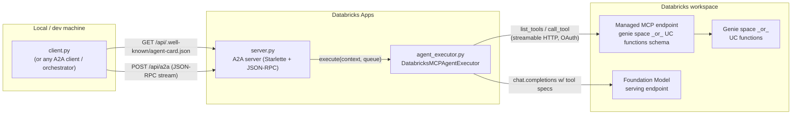
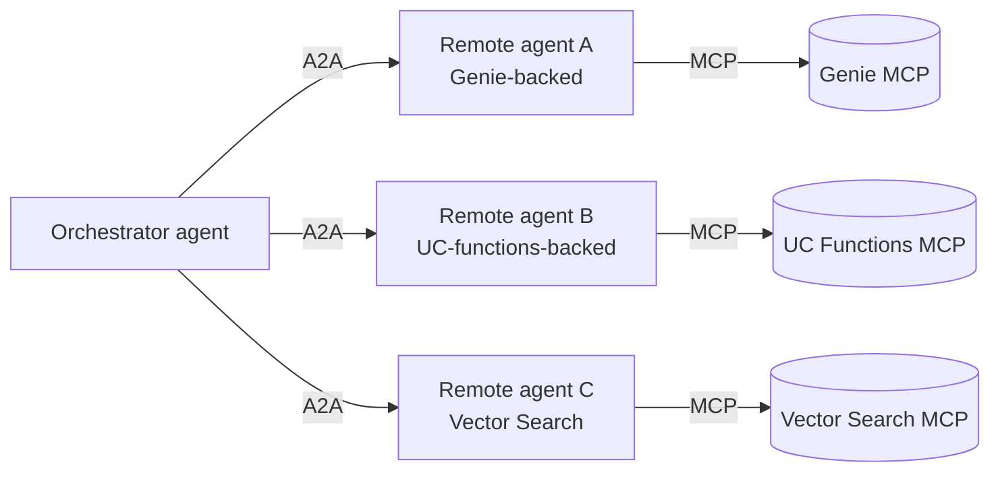
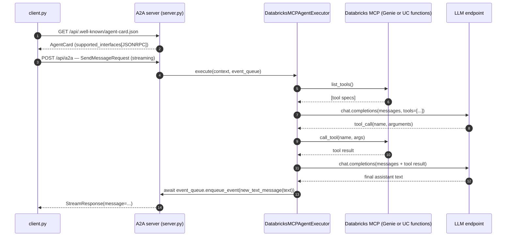

# Databricks A2A + Managed MCP Sample

A single A2A agent that exposes a Databricks-managed MCP server as remote tooling. Demonstrates how the [A2A protocol](https://github.com/a2aproject/a2a-python) (agent-to-agent runtime communication) and [MCP](https://modelcontextprotocol.io) (model-tool plumbing) compose: A2A is the wire between agents, MCP is what one of those agents reaches for to actually do work.

This repo ships **one** A2A agent. The MCP backend it talks to is selectable at runtime — point it at a Genie space or at a Unity Catalog functions schema. In a real deployment you would have many such agents fronted by an orchestrator; that wider topology is illustrated below.

## Architecture



The orchestrator pattern in the broader A2A ecosystem looks like this — each remote agent is a copy of the box above, possibly with a different MCP backend:



## Per-request flow



This is a **single-turn** executor — at most one tool call per request. The two LLM round-trips are visible in `agent_executor.py:SingleTurnMCPAgent.predict`.

## Files

- `server.py` — composes the `AgentCard` and mounts `create_agent_card_routes` + `create_jsonrpc_routes` on a `Starlette` app. The card's URL is built from `DATABRICKS_APP_URL`; the skill description adapts to the configured backend.
- `agent_executor.py` — bridges A2A → Databricks. Translates each MCP tool into an OpenAI-compatible function spec, forwards to a Databricks-served LLM, runs at most one tool call, returns the assistant text via `event_queue.enqueue_event`.
- `client.py` — minimal A2A 1.0 client: resolves the agent card, opens a streaming JSON-RPC connection, prints whichever `StreamResponse` field the server emits.
- `app.yaml` — Databricks Apps entry point declaration with the env-var contract.
- `requirements.txt` — direct deps only; the AppKit runner injects its own broader stack.

## Configuration

The server reads its config entirely from environment variables, so the same code runs locally and on Databricks Apps.

| Variable | Required | Default | Notes |
|---|---|---|---|
| `DATABRICKS_APP_URL` | yes | — | Public URL the agent card advertises. `http://localhost:8000` for local; the App's hostname when deployed. |
| `MCP_BACKEND` | no | `genie` | `genie` or `functions`. |
| `GENIE_SPACE_ID` | if `MCP_BACKEND=genie` | — | The Genie space whose data becomes MCP tools. |
| `UC_FUNCTIONS_CATALOG` | if `MCP_BACKEND=functions` | — | UC catalog name. |
| `UC_FUNCTIONS_SCHEMA` | if `MCP_BACKEND=functions` | — | UC schema name; every function in it becomes a tool. |
| `LLM_ENDPOINT_NAME` | no | `databricks-claude-sonnet-4-6` | Must be a `llm/v1/chat` endpoint that exists pay-per-token on the workspace. |

`client.py` also honours `A2A_BASE_URL` (default `http://localhost:8000/api`), `DATABRICKS_PROFILE` (default `DEFAULT`, used for OAuth on remote URLs), and `PROMPT` (default `"List top 3 distribution centers."`).

## Run locally

Prereqs: Databricks CLI ≥ 1.0, an authenticated CLI profile (`databricks auth login --host <workspace-url>`), and `uv` on `PATH`.

Genie backend:

```bash
databricks apps run-local \
  --prepare-environment \
  --env DATABRICKS_APP_URL=http://localhost:8000 \
  --env MCP_BACKEND=genie \
  --env GENIE_SPACE_ID=<your-genie-space-id> \
  -p <profile>
```

UC functions backend:

```bash
databricks apps run-local \
  --prepare-environment \
  --env DATABRICKS_APP_URL=http://localhost:8000 \
  --env MCP_BACKEND=functions \
  --env UC_FUNCTIONS_CATALOG=<catalog> \
  --env UC_FUNCTIONS_SCHEMA=<schema> \
  -p <profile>
```

This boots the app on `:8000` and a CLI proxy on `:8001`. In a second shell:

```bash
PROMPT="List top 3 distribution centers." uv run python client.py
```

Expected (truncated):

```
INFO:httpx:HTTP Request: GET http://localhost:8000/api/.well-known/agent-card.json "HTTP/1.1 200 OK"
INFO:__main__:A2A Client initialized.
INFO:httpx:HTTP Request: POST http://localhost:8000/api/a2a "HTTP/1.1 200 OK"
name: "databricks-mcp-agent"
...
agent: Based on the data, the top 3 distribution centers by total demand are ...
```

If you sit behind a TLS-intercepting corporate proxy, prefix every uv-touching command with `UV_NATIVE_TLS=1`.

## Deploy to Databricks Apps

The four files needed by Databricks Apps are `server.py`, `agent_executor.py`, `app.yaml`, `requirements.txt`. In the App's environment, override `DATABRICKS_APP_URL` to its public hostname (e.g. `https://<app-name>-<workspace-id>.aws.databricksapps.com`) and set the backend env vars. See the [Databricks Apps docs](https://docs.databricks.com/aws/en/dev-tools/databricks-apps/) for the create/deploy flow.

For remote clients, set `A2A_BASE_URL=https://<app-url>/api` before running `client.py` — the client switches to OAuth bearer auth automatically when the base URL is non-localhost.

## Notes on a2a-sdk version

This repo targets `a2a-sdk[http-server]==1.0.3` and is not compatible with the 0.2.x patterns from earlier revisions of this sample (no `A2AStarletteApplication`, no top-level `AgentCard.url`, async `enqueue_event`, snake-case-uppercase enums). See `CLAUDE.md` for the migration delta.
