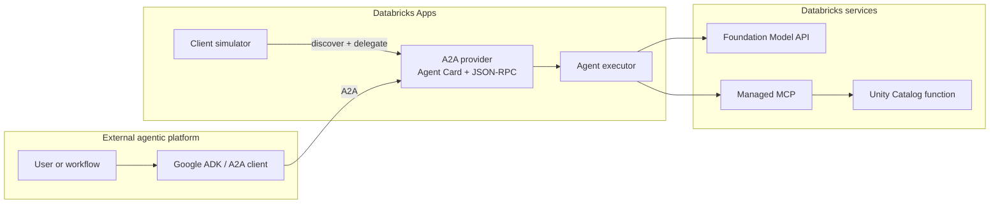

# Databricks services exposed through A2A

## Purpose

This repository demonstrates how an enterprise agent running outside
Databricks—for example, a Google ADK/Gemini orchestrator—can discover and use
Databricks capabilities through the open A2A protocol.

The external client retrieves a standard A2A Agent Card, evaluates the
advertised capabilities, and delegates a task over JSON-RPC. Databricks keeps
Model Serving, managed MCP, Unity Catalog functions, credentials, and execution
details behind the A2A boundary.

The sample deploys two Databricks Apps:

1. **A2A provider** — publishes the Agent Card and JSON-RPC endpoint, invokes a
   Databricks foundation model, and can call Unity Catalog functions through a
   Databricks-managed MCP server.
2. **A2A client simulator** — behaves as a Google-hosted A2A client. It makes
   discovery and delegation visible, displays Agent Card JSON, and explains the
   protocol flow for demonstrations.

## Architecture



The foundation-model capability has a limited conversational scope: A2A, MCP,
Databricks AI and agent services, and enterprise agent architecture. The sample
UC-function capability answers shipping-quote requests. Suggested questions in
the client UI come directly from `AgentSkill.examples` in the discovered Agent
Card.

## Request flow

1. The client resolves `/.well-known/agent-card.json`.
2. The card advertises semantic skills and a JSON-RPC interface URL.
3. The client chooses a capability and sends an A2A `SendMessageRequest`.
4. The provider invokes the scoped foundation model or exposes eligible MCP
   tools to the model.
5. For a tool-backed capability, the provider returns a result only after a
   suitable MCP tool call; otherwise it explicitly declines.
6. The result returns as an A2A streaming response.

The client simulator includes its selected skill in a small application-level
routing envelope inside the standard A2A text part. This is a demo convention,
not a standard A2A `selected_skill_id` field. Plain A2A clients without this
envelope retain autonomous model/tool routing.

## Repository layout

```text
databricks.yml                  Portable two-App bundle
setup/
  create_demo_function.sql     Parameterized SQL template
  render_demo_function.py      Renders the template for a supplied UC name
src/
  a2a-provider/                Headless A2A provider App
  a2a-client/                  Visual A2A client simulator App
google_adk_consumer/           External Google ADK consumer example
tests/                         Configuration and template tests
```

## Prerequisites

- A Databricks workspace with Databricks Apps, Unity Catalog, Model Serving,
  and managed MCP enabled.
- Permission to create Apps and to grant their service principals access to a
  Model Serving endpoint and UC function.
- A chat-capable Databricks Model Serving endpoint available in the workspace.
- A Unity Catalog catalog and schema where you can create a SQL function.
- Databricks CLI authenticated with a profile you explicitly select.
- Python 3.11+ for local tests and SQL template rendering.

Authenticate first:

```bash
databricks auth login --host <workspace-url> --profile <profile>
```

## Deployment configuration

Choose values for every deployment. Nothing in the bundle assumes a workspace,
catalog, schema, profile, user, or public App URL.

```bash
export DATABRICKS_PROFILE=<profile>
export PROVIDER_APP_NAME=<unique-provider-app-name>
export CLIENT_APP_NAME=<unique-client-app-name>
export UC_FUNCTION_NAME=<catalog>.<schema>.a2a_demo_shipping_quote
export LLM_ENDPOINT_NAME=<chat-serving-endpoint-name>
```

App names must be workspace-global, contain only lowercase letters, numbers,
and hyphens, and be no more than 26 characters.

The bundle requires these variables:

| Bundle variable | Meaning |
|---|---|
| `provider_app_name` | Workspace-global name for the headless provider App |
| `client_app_name` | Workspace-global name for the visual client App |
| `uc_function_name` | Existing three-part UC function name |
| `llm_endpoint_name` | Existing chat-capable Model Serving endpoint |

The provider derives its public Agent Card URL from the request's forwarded host
headers. `DATABRICKS_APP_URL` is therefore not required in Databricks Apps; it is
only an optional local-development override.

## Create the sample UC function

The SQL template contains no catalog or schema. Render it with the function name
chosen above and execute it through the profile's default SQL warehouse:

```bash
databricks experimental aitools tools query \
  "$(python3 setup/render_demo_function.py \
      --function-name "$UC_FUNCTION_NAME")" \
  --profile "$DATABRICKS_PROFILE"
```

Alternatively, render the SQL, paste it into the Databricks SQL editor, and run
it there:

```bash
python3 setup/render_demo_function.py \
  --function-name "$UC_FUNCTION_NAME"
```

The deployer must be able to create the function. The provider App service
principal receives only `EXECUTE` through the bundle resource binding.

## Verify the Model Serving endpoint

List ready chat endpoints and select one that exists in your workspace:

```bash
databricks serving-endpoints list \
  --profile "$DATABRICKS_PROFILE" \
  --output json | \
  jq -r '.[] | select(.task == "llm/v1/chat" and .state.ready == "READY") | .name'
```

## Deploy both Apps

```bash
DATABRICKS_AUTH_STORAGE=plaintext \
databricks apps deploy -t dev \
  --var="provider_app_name=$PROVIDER_APP_NAME" \
  --var="client_app_name=$CLIENT_APP_NAME" \
  --var="uc_function_name=$UC_FUNCTION_NAME" \
  --var="llm_endpoint_name=$LLM_ENDPOINT_NAME" \
  --profile "$DATABRICKS_PROFILE"
```

The bundle creates or updates both Apps and configures these least-privilege
resource bindings:

- Provider App → `CAN_QUERY` on the selected Model Serving endpoint.
- Provider App → `EXECUTE` on the selected UC function.
- Client App → `CAN_USE` on the provider App.

No public URL is passed to the bundle. After deployment, retrieve the generated
URLs from the workspace:

```bash
databricks apps get "$PROVIDER_APP_NAME" \
  --profile "$DATABRICKS_PROFILE" --output json | jq -r .url

databricks apps get "$CLIENT_APP_NAME" \
  --profile "$DATABRICKS_PROFILE" --output json | jq -r .url
```

Open the client URL, select **Discover services**, choose an advertised
capability, and try one of the suggested questions.

## Verify deployment status and logs

```bash
databricks apps get "$PROVIDER_APP_NAME" \
  --profile "$DATABRICKS_PROFILE" --output json
databricks apps get "$CLIENT_APP_NAME" \
  --profile "$DATABRICKS_PROFILE" --output json

databricks apps logs "$PROVIDER_APP_NAME" \
  --profile "$DATABRICKS_PROFILE"
databricks apps logs "$CLIENT_APP_NAME" \
  --profile "$DATABRICKS_PROFILE"
```

`apps logs` requires OAuth authentication; PAT authentication may be sufficient
for status checks but not log streaming.

## Test with the framework-neutral A2A client

Get the provider URL and supply it explicitly:

```bash
export A2A_BASE_URL=<provider-app-url>/api
export PROMPT="Give me a shipping quote from Boston to Chicago for 25 kilograms."

UV_SYSTEM_CERTS=1 uv run --system-certs \
  --with-requirements src/a2a-provider/requirements.txt \
  python src/a2a-client/cli.py
```

For a remote App protected by Databricks authentication, the CLI reads the
already exported `DATABRICKS_PROFILE` value to obtain OAuth.

## Consume from Google ADK

Set the provider App URL and authentication profile:

```bash
export DATABRICKS_A2A_APP_URL=<provider-app-url>
export DATABRICKS_PROFILE=<profile>
```

Discover the Databricks Agent Card from the Google-side consumer:

```bash
UV_SYSTEM_CERTS=1 uv run --system-certs \
  --with-requirements requirements-google-adk.txt \
  python -m google_adk_consumer.discover
```

Run the Google ADK development UI:

```bash
GOOGLE_GENAI_USE_VERTEXAI=TRUE \
GOOGLE_CLOUD_PROJECT=<gcp-project> \
GOOGLE_CLOUD_LOCATION=<gcp-region> \
UV_SYSTEM_CERTS=1 uv run --system-certs \
  --with-requirements requirements-google-adk.txt \
  adk web .
```

In Google Cloud, omit `DATABRICKS_PROFILE` and inject
`DATABRICKS_HOST`, `DATABRICKS_CLIENT_ID`, and
`DATABRICKS_CLIENT_SECRET` from Secret Manager. The consumer uses the Databricks
SDK credential chain and attaches a short-lived OAuth token to Agent Card and
JSON-RPC requests.

## Local provider development

Run the provider with explicit local values:

```bash
cd src/a2a-provider

UV_NATIVE_TLS=1 databricks apps run-local \
  --prepare-environment \
  --env DATABRICKS_APP_URL=http://localhost:8000 \
  --env MCP_BACKEND=functions \
  --env UC_FUNCTION_NAME=<catalog>.<schema>.<function> \
  --env LLM_ENDPOINT_NAME=<chat-serving-endpoint-name> \
  --profile <profile>
```

`DATABRICKS_APP_URL` fixes the Agent Card URL for local execution. In deployed
Apps the URL is inferred from reverse-proxy request headers.

## Configuration reference

### Provider runtime

| Environment variable | Required | Description |
|---|---:|---|
| `DATABRICKS_APP_URL` | Local only | Optional public URL override for the Agent Card |
| `MCP_BACKENDS` | No | Comma-separated `functions`, `genie`, or both |
| `MCP_BACKEND` | No | Backward-compatible single-backend selector |
| `UC_FUNCTION_NAME` | For functions | Three-part UC function name; catalog/schema define MCP scope |
| `UC_FUNCTIONS_CATALOG` | Legacy/local | Catalog when `UC_FUNCTION_NAME` is not supplied |
| `UC_FUNCTIONS_SCHEMA` | Legacy/local | Schema when `UC_FUNCTION_NAME` is not supplied |
| `GENIE_SPACE_ID` | For Genie | Genie space exposed through managed MCP |
| `LLM_ENDPOINT_NAME` | Yes | Chat-capable Model Serving endpoint |

### Client runtime

| Environment variable | Required | Description |
|---|---:|---|
| `A2A_PROVIDER_APP_NAME` | Deployed client | Bound provider App name, injected by the bundle |
| `A2A_PROVIDER_URL` | Local only | Direct provider URL override |
| `A2A_BASE_URL` | CLI only | Provider API base URL |
| `PROMPT` | No | CLI prompt |
| `DATABRICKS_PROFILE` | Remote local client | Named profile used to obtain OAuth |

## Security and protocol notes

- OAuth tokens remain on server-side clients and are never returned to the
  browser.
- The client App authenticates to the provider as its App service principal.
- The provider accesses Model Serving and UC functions through explicit App
  resource bindings.
- A2A skills are discovery metadata, not standardized tool selectors.
- The sample executor is single-turn and performs at most one MCP tool call.
- Prompt-based conversational scope is a behavioral boundary, not a substitute
  for authorization or deterministic input validation.

## Run tests

```bash
python3 -m unittest discover -s tests -v
```

The tests cover MCP configuration, dynamic Agent Card URL resolution, function
name validation, and SQL template rendering.
