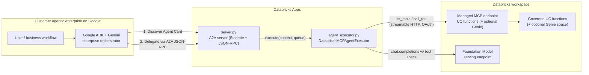
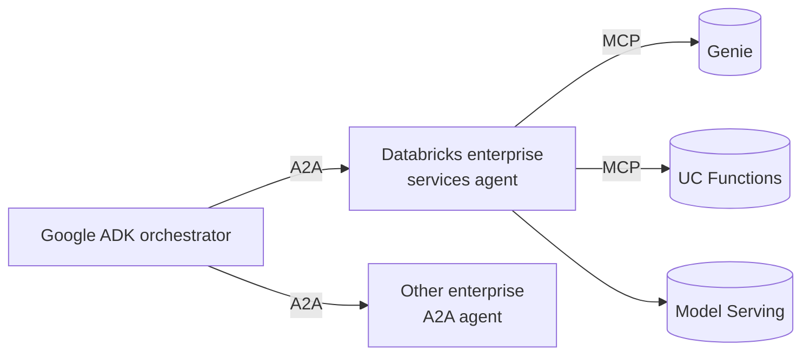
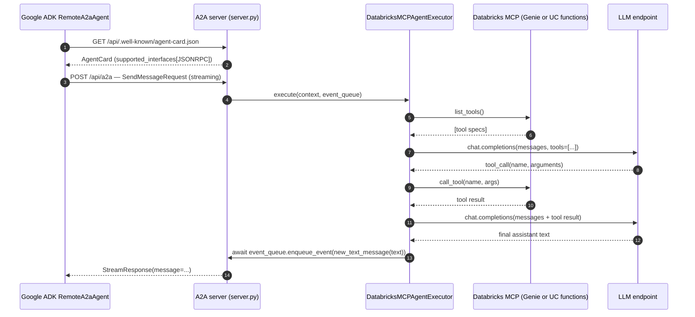

# Databricks A2A + Managed MCP Sample

A customer-facing interoperability example: a Google Agent Development Kit (ADK) orchestrator discovers and consumes governed Databricks services through the open [A2A protocol](https://github.com/a2aproject/a2a-python). The Google agent remains the enterprise entry point; Databricks is a remote A2A provider backed by Model Serving and managed MCP connections to Unity Catalog functions, with optional Genie support.

The boundary is deliberate: Google ADK never needs Databricks-specific tool implementations. It retrieves the standard Agent Card, chooses the remote agent from its advertised skills, and delegates over A2A. Databricks keeps authentication, governance, data access, MCP, and model execution behind that interface.

For the customer-facing talk track and exact proof sequence, see [`DEMO.md`](DEMO.md).

## Architecture



The same Google orchestrator can combine Databricks with other remote A2A agents without moving the orchestration layer:



## Per-request flow



This is a **single-turn** executor — at most one tool call per request. The two LLM round-trips are visible in `agent_executor.py:SingleTurnMCPAgent.predict`.

## Files

- `server.py` — composes the `AgentCard` and mounts `create_agent_card_routes` + `create_jsonrpc_routes` on a `Starlette` app. It uses the injected `DATABRICKS_APP_URL` for the advertised JSON-RPC endpoint, and the card lists each configured Databricks capability.
- `agent_executor.py` — bridges A2A → Databricks. It discovers tools from every configured MCP service, namespaces their names to prevent collisions, forwards them to a Databricks-served LLM, runs at most one tool call, and returns the assistant text via `event_queue.enqueue_event`.
- `databricks_config.py` — validates multi-backend environment configuration, constructs managed MCP URLs, and validates the advertised App URL.
- `client.py` — minimal A2A 1.0 client: resolves the agent card, opens a streaming JSON-RPC connection, prints whichever `StreamResponse` field the server emits.
- `google_adk_consumer/agent.py` — Google ADK/Gemini orchestrator using `RemoteA2aAgent` to discover and delegate to the Databricks App.
- `app.yaml` — Databricks Apps entry point declaration with the env-var contract.
- `databricks.yml` — deploys the App and binds its Model Serving and UC Function resources with least-privilege permissions.
- `requirements.txt` — direct deps only; the AppKit runner injects its own broader stack.

## Configuration

The server reads its config entirely from environment variables, so the same code runs locally and on Databricks Apps.

| Variable | Required | Default | Notes |
|---|---|---|---|
| `DATABRICKS_APP_URL` | yes | — | Public URL that the Agent Card advertises. Use `http://localhost:8000` locally and the Databricks App URL when deployed. |
| `MCP_BACKENDS` | no | auto-detect | Comma-separated `genie`, `functions`, or `genie,functions`. |
| `MCP_BACKEND` | no | auto-detect | Backward-compatible single-backend selector. Ignored when `MCP_BACKENDS` is set. |
| `GENIE_SPACE_ID` | for Genie | — | The Genie space whose data becomes MCP tools. |
| `UC_FUNCTION_NAME` | for deployed UC Functions | — | Authorized function FQN; its catalog/schema become the managed MCP scope. |
| `UC_FUNCTIONS_CATALOG` | for local/legacy UC Functions | — | UC catalog name when `UC_FUNCTION_NAME` is not set. |
| `UC_FUNCTIONS_SCHEMA` | for local/legacy UC Functions | — | UC schema name when `UC_FUNCTION_NAME` is not set. |
| `LLM_ENDPOINT_NAME` | no | `databricks-claude-sonnet-4-6` | Must be a `llm/v1/chat` endpoint that exists pay-per-token on the workspace. |

`client.py` also honours `A2A_BASE_URL` (default `http://localhost:8000/api`), `DATABRICKS_PROFILE` (required for remote OAuth), and `PROMPT` (defaults to a governed shipping-quote request).

## Run locally

Prereqs: Databricks CLI ≥ 1.0, an authenticated CLI profile (`databricks auth login --host <workspace-url>`), and `uv` on `PATH`.

Genie backend:

```bash
databricks apps run-local \
  --prepare-environment \
  --env DATABRICKS_APP_URL=http://localhost:8000 \
  --env MCP_BACKEND=genie \
  --env GENIE_SPACE_ID=<your-genie-space-id> \
  -p <profile>
```

UC functions backend:

```bash
databricks apps run-local \
  --prepare-environment \
  --env DATABRICKS_APP_URL=http://localhost:8000 \
  --env MCP_BACKEND=functions \
  --env UC_FUNCTIONS_CATALOG=<catalog> \
  --env UC_FUNCTIONS_SCHEMA=<schema> \
  -p <profile>
```

Both MCP backends:

```bash
databricks apps run-local \
  --prepare-environment \
  --env DATABRICKS_APP_URL=http://localhost:8000 \
  --env MCP_BACKENDS=genie,functions \
  --env GENIE_SPACE_ID=<your-genie-space-id> \
  --env UC_FUNCTIONS_CATALOG=<catalog> \
  --env UC_FUNCTIONS_SCHEMA=<schema> \
  --profile <profile>
```

This boots the app on `:8000` and a CLI proxy on `:8001`. In a second shell:

```bash
PROMPT="Give me a governed shipping quote from Boston to Chicago for 25 kilograms." uv run python client.py
```

Expected (truncated):

```
INFO:httpx:HTTP Request: GET http://localhost:8000/api/.well-known/agent-card.json "HTTP/1.1 200 OK"
INFO:__main__:A2A Client initialized.
INFO:httpx:HTTP Request: POST http://localhost:8000/api/a2a "HTTP/1.1 200 OK"
name: "databricks-enterprise-services"
...
agent: The governed quote from Boston to Chicago for 25 kg is ...
```

If you sit behind a TLS-intercepting corporate proxy, prefix every uv-touching command with `UV_NATIVE_TLS=1`.

## Deploy to Databricks Apps

The baseline deployment uses a governed UC function plus a Databricks Model Serving endpoint. Create the demo function with `setup/create_demo_function.sql` in the target workspace's SQL editor, or run the file through the default warehouse after authenticating:

```bash
databricks experimental aitools tools query \
  "$(< setup/create_demo_function.sql)" \
  --profile fevm-sdonohoo-demotest
```

Alternatively, replace the bundle variable with an existing function FQN.

`databricks.yml` declares the Model Serving endpoint and UC function as App resources. Deployment automatically grants the App service principal `CAN_QUERY` and `EXECUTE`, respectively:

```bash
databricks apps deploy -t demo \
  --var='uc_function_name=main.default.a2a_demo_shipping_quote' \
  --var='llm_endpoint_name=<chat-endpoint>' \
  --profile <profile>
```

The `demo` target advertises `https://databricks-a2a-elements-7474653063456586.aws.databricksapps.com`, the deterministic URL for this app name in `fevm-sdonohoo-demotest`. After deployment, confirm it with `databricks apps get databricks-a2a-elements --profile fevm-sdonohoo-demotest --output json`.

For remote clients, set the URL and an explicit profile. The client first retrieves and prints the A2A card, then follows the card's JSON-RPC interface URL to query the Databricks-backed service:

```bash
A2A_BASE_URL=https://<app-url>/api \
DATABRICKS_PROFILE=<profile> \
PROMPT="Use an available Databricks capability and explain the result." \
UV_NATIVE_TLS=1 uv run --native-tls python client.py
```

## Demonstrate consumption from Google ADK

The Google-side example is intentionally a separate dependency set; none of its packages are deployed into the Databricks App. Authenticate to Google Cloud and the Databricks workspace, then launch ADK:

First, make capability discovery visible:

```bash
DATABRICKS_A2A_APP_URL=https://<app-url> \
DATABRICKS_PROFILE=fevm-sdonohoo-demotest \
UV_NATIVE_TLS=1 uv run --native-tls \
  --with-requirements requirements-google-adk.txt \
  python -m google_adk_consumer.discover
```

Then launch the Google orchestrator:

```bash
GOOGLE_GENAI_USE_VERTEXAI=TRUE \
GOOGLE_CLOUD_PROJECT=<gcp-project> \
GOOGLE_CLOUD_LOCATION=us-central1 \
DATABRICKS_A2A_APP_URL=https://<app-url> \
DATABRICKS_PROFILE=fevm-sdonohoo-demotest \
UV_NATIVE_TLS=1 uv run --native-tls \
  --with-requirements requirements-google-adk.txt \
  adk web .
```

In the ADK UI, select `google_adk_consumer` and use a prompt that requires a Databricks capability, for example:

> Ask the Databricks agent what governed capabilities it provides, then use the appropriate capability to answer: `<customer-specific data question>`.

The visible proof sequence is:

1. Google ADK resolves the Databricks Agent Card over HTTPS.
2. Gemini sees `databricks_enterprise_services` as a remote sub-agent and delegates.
3. The request crosses only the standard A2A JSON-RPC interface.
4. Databricks selects Genie or a UC function through managed MCP and returns the answer over A2A.

For the local demonstration, `DatabricksOAuth` reads the explicitly named CLI profile. In Google Cloud, omit `DATABRICKS_PROFILE` and provide `DATABRICKS_HOST`, `DATABRICKS_CLIENT_ID`, and `DATABRICKS_CLIENT_SECRET` through the customer's secret manager. The same helper then uses Databricks OAuth machine-to-machine authentication; the A2A interface and ADK agent definition do not change.

## Notes on a2a-sdk version

This repo targets `a2a-sdk[http-server]==1.0.3` and is not compatible with the 0.2.x patterns from earlier revisions of this sample (no `A2AStarletteApplication`, no top-level `AgentCard.url`, async `enqueue_event`, snake-case-uppercase enums). See `CLAUDE.md` for the migration delta.
