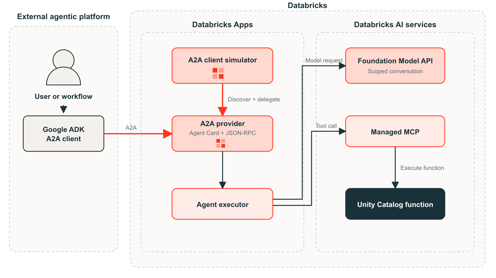

# Governance and Observability for Databricks services exposed through A2A

## Overview

This example demonstrates how an enterprise agent running outside
Databricks—for example, a Google ADK/Gemini orchestrator—can discover and use
governed Databricks capabilities through the open A2A protocol.

The external client retrieves a standard A2A Agent Card, evaluates the
advertised capabilities, and delegates a task over JSON-RPC. Databricks keeps
Unity Gateway model and MCP services, Unity Catalog functions, credentials, and
execution details behind the A2A boundary.

This demo builds on Wenwen Xie's
[Connecting A2A and MCP on Databricks Apps](https://www.linkedin.com/pulse/connecting-a2a-mcp-databricks-apps-practical-example-wenwen-xie-iuzye/)
article and the accompanying
[databricks_a2a_mcp_connection repository](https://github.com/vivian-xie-db/databricks_a2a_mcp_connection).

The bundle includes:

- **A2A provider App** — publishes the Agent Card and JSON-RPC endpoint and
  delegates tasks to the selected Databricks capability.
- **A2A client simulator App** — behaves as a Google-hosted A2A client and makes
  capability discovery, delegation, and the Agent Card visible.
- **Unity Gateway** — governs model and DBSQL MCP access and captures downstream
  model and MCP activity.
- **App telemetry** — exports logs, spans, and metrics from the A2A provider App
  to Unity Catalog.

The foundation-model capability has a limited conversational scope covering
A2A, MCP, Databricks AI and agent services, and enterprise agent architecture.
The sample Unity Catalog function provides shipping quotes.

## Architecture



## Pre-deployment requirements

### 1. Confirm the catalog and schema

Confirm that the target Unity Catalog catalog and schema exist and that you can
create a function and telemetry tables in that schema.

### 2. Create the function

Create the Unity Catalog function used by the App:

```shell
databricks experimental aitools tools query \
  "$(python3 setup/render_demo_function.py \
      --function-name "<catalog>.<schema>.<function>")" \
  --profile <profile>
```

The renderer applies the supplied three-part name to the sample shipping-quote
function in `setup/create_demo_function.sql`. Use the same function name for
`uc_function_name` during deployment.

### 3. Enable MCP tracing

To capture detailed MCP activity from system.ai.dbsql, a metastore admin must enable the unified trace table from **AI Gateway > Govern > Traces**. This is optional and is not required for the MCP service to function.

## Deploy

Supply workspace-specific values directly to the bundle command. For
`foundation_model_resource_name`, use the backing model resource shown in a
`system.ai` model service's `pay_per_token_config.model` field, without the
`models/` prefix.

```bash
databricks apps deploy -t dev \
  --var="provider_app_name=<provider-app-name>" \
  --var="client_app_name=<client-app-name>" \
  --var="uc_function_name=<catalog>.<schema>.<function>" \
  --var="governance_catalog=<catalog>" \
  --var="governance_schema=<schema>" \
  --var="foundation_model_resource_name=system.ai.databricks-<model>" \
  --var="model_service_name=<model-service-name>" \
  --var="model_inference_table_prefix=<model-table-prefix>" \
  --var="telemetry_table_prefix=<app-telemetry-prefix>" \
  --var="sql_warehouse_id=<warehouse-id>" \
  --profile <profile>
```

The bundle creates the Unity Gateway model service and inference table, enables
telemetry for the provider App, and configures the model, function, and SQL
warehouse permissions. See [Governance and observability](docs/governance.md)
for the one-time preview, tracing, and MCP access requirements.

To exercise the provider using the Google A2A SDK without the visual client, see
[Test with the framework-neutral A2A client](docs/framework-neutral-client.md).
